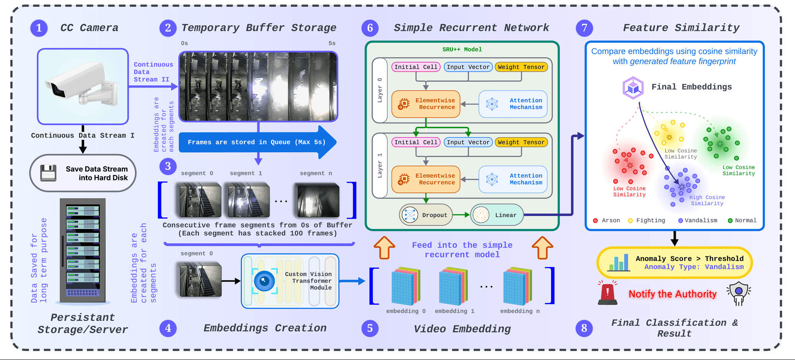
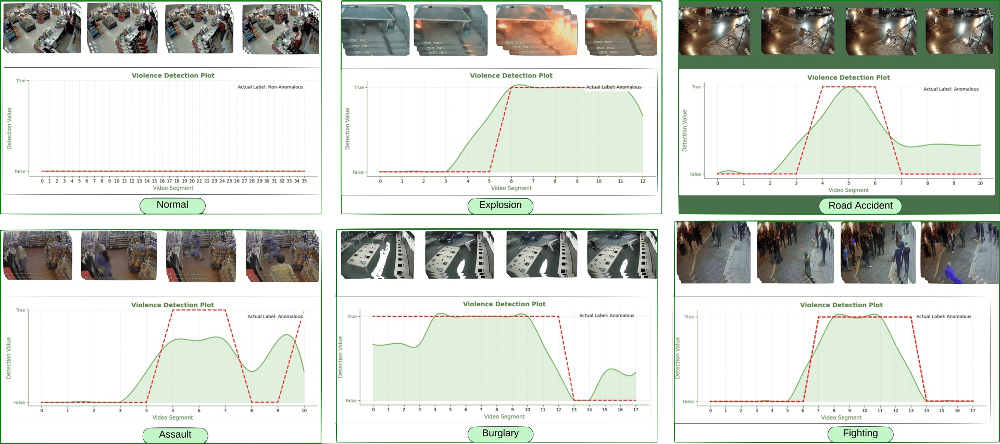

## Vision transformer embedded video anomaly detection using attention driven recurrence

<p align="center">
  A spatio-temporal video anomaly detection framework combining a Vision Transformer,
  attention-driven SRU++, and feature-similarity weighting.
</p>

<p align="center">
  <a href="https://doi.org/10.1016/j.array.2025.100471">
    
  </a>
  
  <a href="LICENSE">
    
  </a>
</p>

<p align="center">
  <strong>Ummay Maria Muna</strong> ·
  <strong>Shanta Biswas</strong> ·
  <strong>Syed Abu Ammar Muhammad Zarif</strong> ·
  <strong>Philip Jefferson Deori</strong> ·
  <strong>Tauseef Tajwar</strong> ·
  <strong>Swakkhar Shatabda</strong>
</p>

<p align="center">
  Published in <em>Array</em>, Volume 27, Article 100471, 2025
</p>

## Overview

Automated video anomaly detection is difficult because abnormal events are sparse, context-dependent, and often embedded in long surveillance recordings. This repository accompanies our published research on a unified framework that:

- segments long videos into manageable clips and labels the anomalous intervals;
- extracts spatial features with a modified pretrained Vision Transformer;
- models temporal dependencies with an efficient, attention-driven SRU++;
- supports binary and multiclass anomaly classification;
- improves multiclass predictions through feature-cluster similarity weighting; and
- applies sliding-window inference to continuous or long-form video.

The approach was evaluated on **UCF-Crime**, **RWF-2000**, and **Smart City CCTV Violence Detection (SCVD)**.

> [!NOTE]
> This repository preserves both the final research direction and the experiments that led to it. The paper is the canonical source for the published architecture, hyperparameters, and results; some notebooks represent earlier CNN, ResNet, SRU, or discarded-window investigations.

## System architecture

<p align="center">
  
</p>

<p align="center">
  <em>
    The deployment pipeline buffers a continuous CCTV stream, creates fixed-length
    segments, extracts transformer embeddings, models temporal context with SRU++,
    applies feature-similarity weighting, and produces the final anomaly decision.
  </em>
</p>

The framework follows eight practical stages:

1. **Video acquisition** — capture a continuous CCTV stream and optionally retain it in persistent storage.
2. **Temporary buffering** — maintain a short queue of recent frames for low-latency processing.
3. **Segmentation** — divide the buffered stream into fixed-length frame sequences.
4. **Feature extraction** — generate spatial representations with a customized Vision Transformer.
5. **Video embedding construction** — preserve the ordered sequence of frame-level embeddings.
6. **Temporal modeling** — process the sequence with a two-layer SRU++ containing attention mechanisms.
7. **Feature-similarity weighting** — compare learned features with class centers using cosine similarity.
8. **Classification** — report the anomaly score and predicted event category.

## Main research contributions

- **Sparse-event preprocessing:** long surveillance videos are segmented and manually relabeled so the model learns from the relevant anomalous intervals.
- **Transformer-based spatial representation:** a modified ViT-Small model generates 2048-dimensional features while retaining global scene context.
- **Efficient temporal reasoning:** SRU++ captures long-range dependencies with highly parallel recurrent computation and multi-head attention.
- **Multiclass anomaly recognition:** the framework identifies distinct anomaly categories instead of producing only a binary normal/anomalous decision.
- **Cluster-based weighting:** class-center similarity is used to refine multiclass prediction scores.
- **Continuous-video inference:** a sliding-window and buffered-stream design extends segment-level training to long or live videos.

## Published results

The final ViT + SRU++ framework achieved the following test performance:

| Dataset | Test accuracy | ROC AUC | PR AUC |
| --- | ---: | ---: | ---: |
| UCF-Crime | **95.14%** | **0.96** | **0.94** |
| RWF-2000 | **92.88%** | **0.95** | **0.94** |
| SCVD | **93.73%** | **0.93** | **0.95** |

For UCF-Crime multiclass classification, the reported per-class ROC AUC values range from **0.91 to 1.00**, while average precision values range from **0.82 to 0.98**.

## Qualitative anomaly localization

<p align="center">
  
</p>

<p align="center">
  <em>
    Segment-level predictions for Normal, Explosion, Road Accident, Assault,
    Burglary, and Fighting videos. The green curve is the predicted anomaly score;
    the red dashed line indicates the annotated anomalous interval.
  </em>
</p>

These examples illustrate how a full video is converted into sequential segment predictions. Normal footage remains below the decision region, while anomalous events produce localized score increases around the annotated intervals.

## Datasets and preprocessing

| Dataset | Original videos | Clip duration | Segments after augmentation | Train / test |
| --- | ---: | ---: | ---: | ---: |
| UCF-Crime | 1,900 | 10 seconds | 7,000 | 5,600 / 1,400 |
| RWF-2000 | 2,000 | 5 seconds | 4,000 | 3,200 / 800 |
| SCVD | 484 | 5 seconds | 1,000 | 800 / 200 |

The preprocessing workflow includes:

1. removing unsuitable or ambiguous samples;
2. segmenting long recordings into fixed-duration clips;
3. reducing the number of frames at regular intervals;
4. manually assigning binary or multiclass labels;
5. removing repetitive or redundant surveillance segments; and
6. augmenting the curated clips before the 80/20 split.

For UCF-Crime, the ambiguous **arrest** and **shoplifting** categories were excluded from the multiclass study. See [base-dataset/README.md](base-dataset/README.md) and [dataset/README.md](dataset/README.md) for the repository’s dataset notes.

## Environment setup

Python 3.9 or newer is recommended. A CUDA-capable GPU is strongly recommended for feature extraction and recurrent-model training.

```bash
python -m venv .venv
source .venv/bin/activate
pip install -r src/requirements.txt
```

The core stack includes PyTorch, torchvision, SRU/SRU++, timm, OpenCV, scikit-learn, NumPy, Matplotlib, and Seaborn.

## Paper and citation
- [DOI: 10.1016/j.array.2025.100471](https://doi.org/10.1016/j.array.2025.100471)
- [ScienceDirect article](https://www.sciencedirect.com/science/article/pii/S2590005625000980)
- [Citation File Format](CITATION.cff)

If this work supports your research, please cite:

```bibtex
@article{MUNA2025100471,
  title   = {Vision transformer embedded video anomaly detection using attention driven recurrence},
  journal = {Array},
  volume  = {27},
  pages   = {100471},
  year    = {2025},
  issn    = {2590-0056},
  doi     = {10.1016/j.array.2025.100471},
  author  = {Ummay Maria Muna and Shanta Biswas and Syed Abu Ammar Muhammad Zarif and Philip Jefferson Deori and Tauseef Tajwar and Swakkhar Shatabda}
}
```

## License

The repository code is available under the [MIT License](LICENSE). Dataset videos remain subject to the licenses and terms of their original providers.